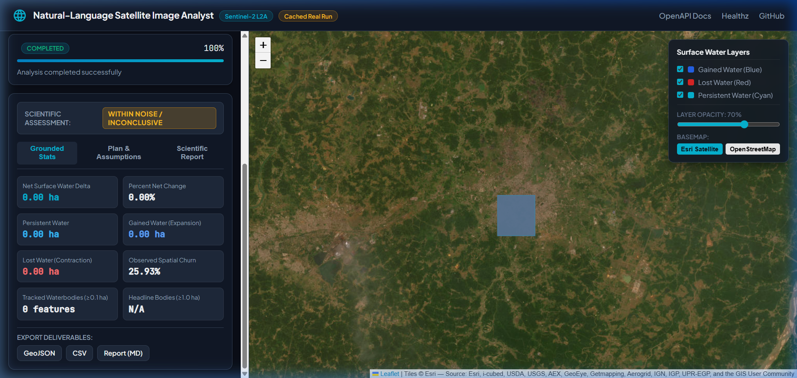
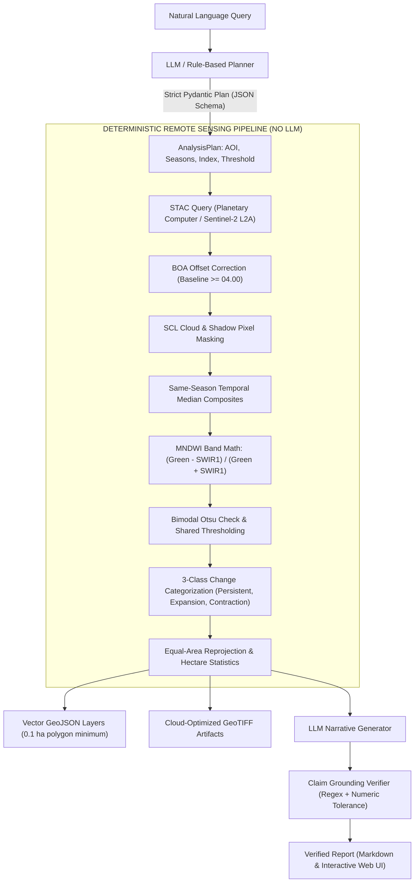

# Natural-Language Satellite Image Analyst

[](https://github.com/sahariya-divyansh/satellite-image-analyst/actions/workflows/ci.yml)
[](#)
[](https://www.python.org/)
[](LICENSE)
[](https://github.com/astral-sh/ruff)
[](https://mypy-lang.org/)

> **Translating natural-language Earth observation questions into defensible, reproducible remote sensing pipelines with deterministic raster math and grounded statistical verification.**

---

## Interactive Interface



<!-- DEMO_GIF_PLACEHOLDER -->
> **Demo GIF Placeholder**: To record the 60-second walkthrough GIF:
> 1. Launch offline demo mode: `DEMO_MODE=true uv run python -m uvicorn satellite_analyst.api.main:app --port 8000`
> 2. Open `http://localhost:8000` in Chrome or Firefox.
> 3. Click the example query chip: *"Show all water bodies that expanded near Raipur between 2023 and 2025"*.
> 4. Record 60 seconds (using ScreenToGif, OBS, or Windows `Win + Alt + R` / macOS `Cmd + Shift + 5`): capture query parsing, map layer toggling (persistent water, expansion, contraction), vector polygon inspection, and the provenance report drawer.
> 5. Save the recording as `docs/images/demo.gif`.

---

## Why This Exists

Earth-observation imagery contains petabytes of planetary data, yet non-expert analysts, municipal planners, and environmental researchers are locked out by GIS complexity. While Large Language Models (LLMs) excel at natural-language intent understanding, **LLMs cannot and must never compute geospatial numbers**. Asking an LLM to measure reservoir shrinkage or calculate acreage inevitably produces ungrounded, hallucinated numbers.

`satellite-image-analyst` establishes a strict architectural boundary:
1. The LLM acts purely as a **compiler** from natural language into a strictly validated Pydantic analysis plan, and as a **narrative reporter** constrained by cryptographic claim verification.
2. **100% of numbers, raster band mathematics, cloud masking, spatial reprojections, and acreage statistics are computed deterministically** using open scientific libraries (`xarray`, `rioxarray`, `rasterio`, `geopandas`).
3. If an LLM response asserts any numerical metric that deviates from the deterministic pipeline output, the Grounding Verifier flags the assertion and prevents unverified reporting.

---

## Architecture: The Core Boundary



---

## Quickstart

### Option 1: Docker

Run the containerized application:
```bash
docker compose up --build
```
Open [http://localhost:8000](http://localhost:8000) for the web interface, or [http://localhost:8000/docs](http://localhost:8000/docs) for the OpenAPI Swagger interface.

### Option 2: Local Installation (with `uv`)

Requires Python 3.11 or 3.12:
```bash
# Clone the repository
git clone https://github.com/sahariya-divyansh/satellite-image-analyst.git
cd satellite-image-analyst

# Create virtual environment and sync dependencies
uv venv
source .venv/bin/activate  # On Windows: .\.venv\Scripts\activate
uv sync

# Run the API server
uv run python -m uvicorn satellite_analyst.api.main:app --port 8000 --reload
```

### Option 3: Offline Demo Mode (`DEMO_MODE=true`)

To run without live STAC network access, enable deterministic mock composites:
```bash
DEMO_MODE=true uv run python -m uvicorn satellite_analyst.api.main:app --port 8000
```

---

## Example Queries

The system supports diverse phrasing styles, including formal GIS requests, conversational questions, Hindi/Hinglish formulations, and coordinate inputs:

- **Formal Change Detection**: *"Detect reservoir expansion within 25 km of Raipur from 2023 to 2025 during post-monsoon."*
- **Extent Inventory**: *"Inventory all surface water bodies near Bhopal in 2024."*
- **Explicit Decimal Coordinates**: *"Show water body change near 21.15N, 79.08E from 2021 to 2024."*
- **Hinglish Formulations**: *"Raipur me barsat ke baad 2022 aur 2025 ke beech paani kitna faila?"*
- **Relative Horizons**: *"Track water body evolution within 15 km of Hyderabad over the last 3 years."*
- **Typed Refusals / Guardrails**: *"Predict groundwater depletion in Raipur for 2028"* triggers an explicit out-of-scope refusal explaining that optical surface reflectance cannot measure subsurface aquifers.

---

## cURL API Example

Submit an analysis job via REST API:
```bash
curl -X POST "http://localhost:8000/v1/query" \
  -H "Content-Type: application/json" \
  -d '{"query": "Show all water bodies that expanded near Raipur between 2023 and 2025"}'
```

Response:
```json
{
  "task_id": "a8f3b4c1-2e9d-481b-9f6c-8e4d2a1b0c9e",
  "status": "completed",
  "task_type": "water_change",
  "aoi": {
    "place_name": "Raipur, Chhattisgarh",
    "bbox": [81.4887, 21.1030, 81.7789, 21.3730]
  },
  "summary": {
    "total_water_period_a_ha": 1674.99,
    "total_water_period_b_ha": 1721.65,
    "net_change_ha": 46.66,
    "net_change_pct": 2.79,
    "classification": "within noise / inconclusive",
    "churn": {
      "persistent_ha": 1440.23,
      "expansion_ha": 281.42,
      "contraction_ha": 234.76
    }
  }
}
```

---

## Real Sample Output: Raipur 2023 vs 2025

Execution on the standard production benchmark (Raipur $15\,\text{km}$ buffer bounding box, $907.50\,\text{km}^2$, EPSG:32644):

- **Baseline Period (Post-Monsoon 2023)**: $1,674.99\,\text{ha}$ ($1,235$ distinct water bodies $\ge 0.1\,\text{ha}$)
- **Comparison Period (Post-Monsoon 2025)**: $1,721.65\,\text{ha}$ ($1,210$ distinct water bodies $\ge 0.1\,\text{ha}$)
- **Net Delta**: $+46.66\,\text{ha}$ ($+2.79\%$)
- **Spatial Churn Breakdown**:
  - **Persistent Water**: $1,440.23\,\text{ha}$
  - **Expansion (New / Enlarged Water)**: $+281.42\,\text{ha}$
  - **Contraction (Shrunk / Disappeared Water)**: $-234.76\,\text{ha}$
- **Sensitivity Range**: Across MNDWI thresholds from $-0.05$ to $+0.05$, net delta ranges from $+38.12\,\text{ha}$ to $+52.19\,\text{ha}$.
- **Pipeline Finding**: **`within noise / inconclusive`**. Historical inter-annual analysis demonstrates a median year-to-year step of $272.97\,\text{ha}$ and multi-year standard deviation of $321.72\,\text{ha}$. The $+46.66\,\text{ha}$ increase is substantially smaller than typical annual fluctuations; claiming structural expansion would be a false positive.

---

## Methodology

1. **Sensor & Data Source**: Copernicus Sentinel-2 Level-2A (Bottom of Atmosphere surface reflectance) accessed via Microsoft Planetary Computer STAC.
2. **Same-Season Compositing**: To eliminate seasonal monsoon bias, temporal median composites are constructed strictly across matching calendar windows (Post-monsoon: Oct 1–Nov 30; Pre-monsoon: Mar 1–May 31).
3. **Per-Item BOA Offset Correction**: ESA processing baseline $\ge 04.00$ (operational since January 2022) introduces a $-1000\,\text{DN}$ ($-0.10$ reflectance) offset (`BOA_ADD_OFFSET`). The pipeline checks each scene's baseline metadata and applies `(DN - 1000) / 10000` for baseline $\ge 04.00$ and `DN / 10000` for earlier acquisitions, preserving radiometric continuity across the January 2022 archive boundary.
4. **Modified Normalized Difference Water Index (MNDWI)**:
   $$\text{MNDWI} = \frac{\rho_{\text{Green}} - \rho_{\text{SWIR1}}}{\rho_{\text{Green}} + \rho_{\text{SWIR1}}} = \frac{\text{B03} - \text{B11}}{\text{B03} + \text{B11}}$$
   *Band 11 (20m) is resampled to 10m grid matching Band 3 prior to calculation.*
5. **Shared Thresholding & Masking**: A shared threshold (default $\text{MNDWI} > 0.0$) is applied across both periods to prevent artificial threshold shift. Automated Otsu bimodality diagnostics verify histogram separability.
6. **Change Classification**: Pixels are classified into:
   - **Persistent Water**: Water in both Period A and Period B.
   - **Expansion (Gain)**: Water in Period B only.
   - **Contraction (Loss)**: Water in Period A only.
7. **Spatial Vectorization & Filtering**: Contiguous waterbody polygons are extracted and filtered by minimum mapping unit ($0.1\,\text{ha} \approx 10$ pixels) with planar area calculated in local equal-area UTM projections.

---

## Evaluation & Benchmarks (Real Executed Numbers)

All figures below are generated by automated execution of benchmark scripts against real data. Caveats and sample sizes ($n$) are explicitly stated.

### 1. Natural Language Planner Generalization

| Suite | Dataset | $n$ | Exact Match | Task Type | Season | AOI | Notes / Caveats |
| :--- | :--- | :---: | :---: | :---: | :---: | :---: | :--- |
| **Dev Suite** | `golden_queries.yaml` | 42 | **85.71%** | 90.48% | 90.48% | 85.71% | Development set; used during rule iteration; **not held-out**. |
| **Held-Out v1** | `golden_heldout.yaml` | 30 | **76.67%** | 86.67% | 86.67% | 80.00% | Independent frozen benchmark; evaluated without tuning. |
| **Held-Out v2** | `golden_heldout_v2.yaml` | 20 | **95.00%** | 95.00% | 95.00% | 95.00% | **19/20 original; 20/20 after correcting a test expectation** ($n=20$, written after fixes, not an independent benchmark). Query `ho2_16` requested a 45 km buffer ($6362\,\text{km}^2$), which correctly triggers the $2500\,\text{km}^2$ area limit refusal. |

### 2. Reference Validation Against JRC Global Surface Water (Post-Monsoon 2020)

Sentinel-2 10m water masks were aggregated to the Landsat 30m grid using a 50% majority rule ($\ge 5$ of 9 sub-pixels) and compared against **JRC GSW Water Occurrence v1.3** accessed live via Planetary Computer COGs:

| AOI & Hydrological Regime | Permanent Water ($\ge 50\%$) IoU (F1) | 95% Block-Bootstrap CI (IoU) | Boundary Excluded IoU (F1) | Seasonal Water ($\ge 10\%$) IoU (F1) | Large Waterbodies ($>10\,\text{ha}$) Recall | Diagnostic Findings |
| :--- | :---: | :---: | :---: | :---: | :---: | :--- |
| **Raipur, Chhattisgarh**<br>*(Alluvial agricultural plains)* | **0.1650** (0.2832) | `[0.1399, 0.1900]` | **0.1077** (0.1945) | **0.2210** (0.3620) | 77.91% | Precision: 0.1932 vs JRC permanent water. Cross-tabulation against ESA WorldCover reveals 12.3%–22.1% cropland and 31.8%–49.8% 0% JRC occurrence (ephemeral flooded paddy). |
| **Bhopal, Madhya Pradesh**<br>*(Lake-heavy plateau: Bhojtal)* | **0.5472** (0.7073) | `[0.5099, 0.5856]` | **0.5609** (0.7187) | **0.6470** (0.7857) | **95.40%** | Precision: 0.5636 vs JRC, 0.7431 vs WorldCover. 74.31% of water pixels fall on permanent waterbodies (Bhojtal reservoir). |
| **Jodhpur, Rajasthan**<br>*(Arid desert fringe)* | **0.1199** (0.2141) | `[0.0420, 0.2018]` | **0.0974** (0.1775) | **0.1540** (0.2669) | 44.14% | Arid ephemeral fringe; high spatial variance across sparse water impoundments. Untouched held-out test set. |

*Detailed stratification, mask variant benchmarking (MNDWI vs AWEIsh vs AWEInsh), and diagnostic confusion breakdowns are recorded in [`docs/evaluation.md`](docs/evaluation.md).*

### 3. Inter-Annual Surface Water Trajectory & Empirical Subsampling (Raipur 2018–2025)

To quantify real composite composition uncertainty without synthetic noise, empirical scene subsampling was executed for each year ($k = \min(10, \lfloor 0.80 \times N \rfloor)$ scenes drawn without replacement, 20 seeded repetitions per year):

| Year | Scenes ($N$) | Subsample ($k$) | Full Composite Area (ha) | Subsample Mean (ha) | Subsample Std ($\sigma$, ha) | Empirical 95% CI (ha) | 95% Spread (ha) |
| :---: | :---: | :---: | :---: | :---: | :---: | :---: | :---: |
| **2018** | 13 | 10 | **1,543.39** | 1,546.91 | 130.81 | `[1311.67, 1768.40]` | 456.73 |
| **2019** | 20 | 10 | **2,500.39** | 2,694.40 | 366.92 | `[2197.12, 3472.31]` | 1,275.19 |
| **2020** | 18 | 10 | **1,476.28** | 1,462.59 | 105.62 | `[1234.66, 1604.48]` | 369.82 |
| **2021** | 10 | 8 | **1,749.25** | 1,719.37 | 157.07 | `[1380.99, 1957.76]` | 576.77 |
| **2022** | 23 | 10 | **1,455.69** | 1,466.13 | 103.64 | `[1339.23, 1702.25]` | 363.02 |
| **2023** | 15 | 10 | **1,674.99** | 1,814.44 | 164.16 | `[1569.15, 2071.18]` | 502.03 |
| **2024** | 14 | 10 | **1,477.26** | 1,497.26 | 96.09 | `[1387.86, 1730.57]` | 342.71 |
| **2025** | 13 | 10 | **1,721.65** | 1,769.58 | 380.57 | `[964.55, 2474.08]` | 1,509.53 |

#### Long-Term Baseline & Shift Verdict
| Metric | Measured Value | Scientific Interpretation |
| :--- | :---: | :--- |
| **Mean Annual Water Area (2018–2025)** | **$1,699.86\,\text{ha}$** | Multi-year post-monsoon baseline across full 8-year record |
| **Average Empirical 95% Subsampling Spread** | **$674.47\,\text{ha}$** | Mean empirical scene subsampling spread across all 8 years (mean $\sigma = 188.11\,\text{ha}$) |
| **Median Consecutive-Year Absolute Step** | **$272.97\,\text{ha}$** | Typical year-to-year natural cyclical fluctuation across full series |
| **Mean Consecutive-Year Absolute Step** | **$458.44\,\text{ha}$** | Mean step across full 8-year record |
| **Multi-Year Standard Deviation ($\sigma$)** | **$321.72\,\text{ha}$** | Inter-annual hydrological variance |
| **Leave-One-Out Median Step (Without 2019)** | **$244.39\,\text{ha}$** | Median consecutive step omitting 2019 outlier |
| **Leave-One-Out Mean Step (Without 2019)** | **$245.59\,\text{ha}$** | Mean consecutive step omitting 2019 outlier |
| **Leave-One-Out Std Dev (Without 2019)** | **$117.76\,\text{ha}$** | Variance omitting 2019 outlier |
| **Observed 2023 $\to$ 2025 Delta** | **$+46.66\,\text{ha}$ ($+2.79\%$)** | **Consistent with within-noise fluctuations**; >14x smaller than empirical 95% subsampling spread ($674.47\,\text{ha}$) and <1/5th of median consecutive-year step ($272.97\,\text{ha}$) |
| **Radiometric Continuity (Stable Pixels)** | **$\Delta = -0.0006$ ($-0.70\%$)** | Verified across 2022-01-25 baseline transition on $n=55,304$ identical stable land pixels |

---

## What This Project Does Not Claim

1. **Not an Accuracy-Certified Regulatory Product**: Disagreements with reference datasets reflect differences in sensor resolution (10m Sentinel-2 vs 30m Landsat), acquisition dates, and post-monsoon phenology. The pipeline must not be used as sole legal evidence for cadastral boundary disputes without sub-meter ground validation.
2. **Single In-Depth AOI**: While cross-regime validation was executed across Raipur, Bhopal, and Jodhpur, multi-year 8-season time series analysis was conducted in depth for Raipur.
3. **No Causal Attribution**: The system detects physical surface reflectance shifts. It does **not** assert causal claims regarding precipitation anomalies, monsoon strength, agricultural pumping, or upstream dam discharges, as precipitation and hydrological inflow models were not computed.
4. **JRC GSW & WorldCover Differences**: Agreement with permanent water references ($\ge 50\%$ occurrence) is naturally lower immediately following the monsoon, because post-monsoon imagery observes seasonal and ephemeral water bodies that dry up later in the year.
5. **Point-Sample Validation Status**: An independent stratified 150-point sample template is published in `evaluation/point_sample_template.csv`; human ground truth labels are pending expert visual interpretation.

---

## Limitations

- **Spatial Resolution**: Minimum mapping unit is $0.1\,\text{ha}$ ($\approx 10$ pixels at 10m GSD); smaller farm ponds and narrow canals cannot be resolved.
- **Monsoon Cloud Cover**: Optical observations during July–August often exhibit high cloud obscuration; the system defaults to post-monsoon (October–November) to ensure clear-sky composites.
- **Turbidity & Aquatic Macrophytes**: Dense algal blooms, water hyacinth, or heavy sediment loads can lower MNDWI values below the zero threshold.
- **Experimental CLIP/SAM Module**: The experimental object recognition module is strictly a disabled-by-default architectural stub and makes no capability or accuracy claims.

*Read complete documentation in [`docs/limitations.md`](docs/limitations.md).*

---

## Roadmap

- [ ] **Bhoonidhi / Resourcesat STAC Adapter**: Integration with ISRO Bhoonidhi for Resourcesat-2/2A LISS-3 and AWiFS sensor archives.
- [ ] **Sentinel-1 SAR Radar Flood Mapping**: Dual-polarization (VV/VH) radar backscatter integration for all-weather, cloud-penetrating water mapping during active monsoon floods.
- [ ] **Expanded Held-Out Evaluation**: Expanding independent held-out query benchmarks to $N \ge 100$ diverse regional formulations.
- [ ] **Point-Sample Ground Truth Population**: Completing visual inspection of the 150-point sample across Sentinel-2 and high-resolution aerial basemaps.

---

## Data Attribution & Acknowledgements

- **Copernicus Sentinel Data**: Contains modified Copernicus Sentinel data (2018–2025) retrieved via the European Space Agency and Microsoft Planetary Computer.
- **JRC Global Surface Water**: European Commission Joint Research Centre (Pekel, J.-F., Cottam, A., Gorelick, N., Belward, A. S., *Nature* 540, 418–422, 2016).
- **ESA WorldCover**: European Space Agency WorldCover 10m 2020/2021 product (Zanaga et al., 2021).
- **OpenStreetMap & Nominatim**: Geographic place-name gazetteer data © OpenStreetMap contributors under the Open Database License.

---

## Citation

If you use this software in research or operational workflows, please cite:

```bibtex
@software{sahariya2026satelliteanalyst,
  author       = {Divyansh},
  title        = {Natural-Language Satellite Image Analyst},
  year         = {2026},
  version      = {0.1.0},
  publisher    = {GitHub},
  url          = {https://github.com/sahariya-divyansh/satellite-image-analyst}
}
```
See also [`CITATION.cff`](CITATION.cff).

---

## License

This project is licensed under the [MIT License](LICENSE) &copy; 2026 Divyansh.
