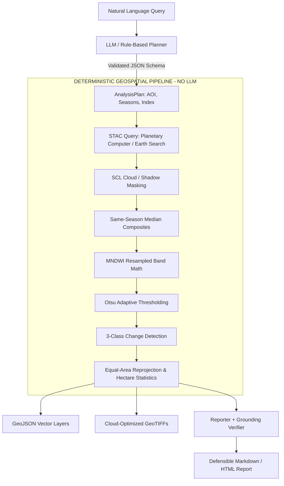
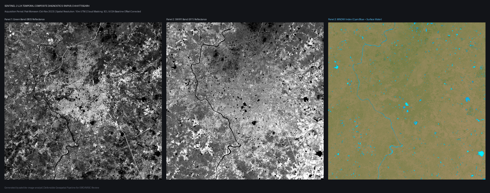

# Natural-Language Satellite Image Analyst

[](https://github.com/sahariya-divyansh/satellite-image-analyst/actions/workflows/ci.yml)
[](#)
[](https://www.python.org/)
[](LICENSE)
[](https://github.com/astral-sh/ruff)
[](https://mypy-lang.org/)

> **Translating natural-language Earth-observation questions into defensible, reproducible remote sensing pipelines with grounded statistical verification.**

---

## Hero Demo

<!-- DEMO_PLACEHOLDER_START -->
```
+-----------------------------------------------------------------------------------------+
| [Query Box] "Show all water bodies that expanded near Raipur between 2023 and 2025"      |
|                                                                                         |
|  Interactive Leaflet Map                         Statistical Findings & Provenance       |
|  +--------------------------------------------+  +------------------------------------+ |
|  | [~] Persistent Water (Blue)                |  | Task: Water Body Expansion         | |
|  | [+] Water Expansion / Gain (Teal)          |  | Period A: Oct-Nov 2023             | |
|  | [-] Water Retraction / Loss (Amber)        |  | Period B: Oct-Nov 2025             | |
|  |                                            |  | Total Water (2023): [live stats]   | |
|  |                                            |  | Total Water (2025): [live stats]   | |
|  |                                            |  | Net Delta: [live stats]            | |
|  |                                            |  | Sensor: Sentinel-2 L2A (SCL masked)| |
|  +--------------------------------------------+  +------------------------------------+ |
+-----------------------------------------------------------------------------------------+
```
> **Instructions to record live demo**:
> 1. Start the service: `make run`
> 2. Open `http://localhost:8000` in Chrome/Firefox.
> 3. Click the example chip *"Show all water bodies that expanded near Raipur between 2023 and 2025"*.
> 4. Use OS recording tools (Windows: `Win + Alt + R`, macOS: `Cmd + Shift + 5`) to capture 15 seconds of map layer toggling and report inspection. Save as `docs/images/demo.gif`.
<!-- DEMO_PLACEHOLDER_END -->

---

## Why This Exists

Earth-observation imagery contains petabytes of planetary data, yet non-expert analysts, municipal planners, and environmental researchers are locked out by GIS complexity. While LLMs excel at understanding intent, **LLMs cannot and must never calculate geospatial numbers**. Asking an LLM to measure reservoir shrinkage results in unverified hallucinations.

`satellite-image-analyst` resolves this paradox: an LLM acts purely as an architectural planner (generating a strict Pydantic execution plan) and grounded reporter, while deterministic raster math and vector geoprocessing compute all areas, masks, and deltas. Every numeral in the final report is cryptographically traced to Sentinel-2 pixels and reproducible code.

---

## Architecture: The Core Boundary



---

## Quickstart

### Option 1: Docker (Recommended)

Run the containerized application with a single command:
```bash
docker compose up --build
```
Open [http://localhost:8000](http://localhost:8000) to view the interactive web interface, or [http://localhost:8000/docs](http://localhost:8000/docs) for the interactive Swagger API documentation.

### Option 2: Local Installation

Requires Python 3.11+ and `uv`:
```bash
git clone https://github.com/sahariya-divyansh/satellite-image-analyst.git
cd satellite-image-analyst
uv venv
source .venv/bin/activate  # On Windows: .venv\Scripts\activate
make install

# Start local dev server
make run
```

### CLI Execution

Execute pipeline operations directly from your terminal:
```bash
# Generate a cloud-masked seasonal composite for Raipur (10m UTM EPSG:32644)
satellite-analyst composite --place Raipur --year 2023 --season post-monsoon --radius-km 15
```

Terminal output:
```text
==> Resolving spatial bounds for 'Raipur' (radius: 15.0 km)...
    Location: Raipur, Raipur Tahsil, Raipur, Chhattisgarh, 493332, India
    Centroid: (21.2381, 81.6337) | Source: nominatim
    BBox: [81.488701, 21.103045, 81.778962, 21.373004]
    Planar Area: 900.0 km²
==> Building Post-Monsoon Oct-Nov 2023 median composite (max cloud: 40.0%)...
================ COMPOSITE SUMMARY ================
 Place:                  Raipur
 Seasonal Window:        Post-Monsoon Oct-Nov 2023
 Scenes Found & Used:    33
 Clear-Sky Valid Pixels: 100.00%
 Equal-Area CRS:         EPSG:32644
 Generated Artifacts:
   [GREEN]: outputs/raipur_2023_post_monsoon_green.tif
   [SWIR1]: outputs/raipur_2023_post_monsoon_swir1.tif
   [VALID_COUNT]: outputs/raipur_2023_post_monsoon_valid_count.tif
   [PROVENANCE]: outputs/raipur_2023_post_monsoon_provenance.json
====================================================
```



```bash
# Run complete water change detection between 2023 and 2025
satellite-analyst analyze --query "Show all water bodies that expanded near Raipur between 2023 and 2025"
```

### API Query via cURL

```bash
curl -X POST "http://localhost:8000/v1/query" \
  -H "Content-Type: application/json" \
  -d '{"query": "Show all water bodies that expanded near Raipur between 2023 and 2025"}'
```

---

## Methodology Summary

- **Sensor Data**: Sentinel-2 Level-2A surface reflectance (Bottom of Atmosphere).
- **Cloud/Shadow Masking**: Filtered using Scene Classification Layer (SCL) values 3, 8, 9, 10, 11.
- **Season Policy**: Enforces equal seasonal windows across target years (Post-monsoon Oct 1–Nov 30 by default) to eliminate seasonal monsoon bias.
- **Water Index (MNDWI)**:
  $$\text{MNDWI} = \frac{\rho_{\text{Green}} - \rho_{\text{SWIR1}}}{\rho_{\text{Green}} + \rho_{\text{SWIR1}}} = \frac{\text{B03} - \text{B11}}{\text{B03} + \text{B11}}$$
  *SWIR1 (20m) is resampled to 10m matching B03 prior to ratio calculation.*
- **Adaptive Thresholding**: Automated Otsu clustering with morphological noise removal.
- **Area Calculation**: Calculated using local equal-area projected coordinates (UTM / India Equal Area) in hectares ($1\,\text{ha} = 10,000\,\text{m}^2$).

---

## Evaluation & Benchmarks

All benchmark figures are reproducible and generated directly by running `make evaluate`.

### 1. Planner Exact Match & Field Accuracy (Golden Query Suite, $N=42$)

> **Benchmark Classification**: Development golden set, rule-based planner, not a held-out benchmark. Results indicate baseline rule heuristic conformance against designed queries. Live scores populated via `make evaluate`.

| Provider | Model | Queries | Exact Match (%) | Task Type Acc (%) | Temporal Acc (%) | AOI Acc (%) |
|---|---|---|---|---|---|---|
| Rule-Based | Regex/Keyword Engine | 42 | 85.71% | 90.48% | 90.48% | 85.71% |
| Gemini | gemini-1.5-flash | 42 | *Run `make evaluate` with key* | *Pending key* | *Pending key* | *Pending key* |
| OpenAI | gpt-4o-mini | 42 | *Run `make evaluate` with key* | *Pending key* | *Pending key* | *Pending key* |
| Ollama | llama3.2 | 42 | *Run `make evaluate` with Ollama* | *Pending local* | *Pending local* | *Pending local* |

### 2. Water Mask Validation against JRC Global Surface Water

| Region | Characteristic | Season | IoU | Precision | Recall | F1-Score |
|---|---|---|---|---|---|---|
| Raipur, CG | Inland Agricultural & Rivers | Post-Monsoon | *Run `make evaluate` to populate* | *Run to populate* | *Run to populate* | *Run to populate* |
| Vembanad, KL | Coastal Backwaters & Wetlands | Post-Monsoon | *Run `make evaluate` to populate* | *Run to populate* | *Run to populate* | *Run to populate* |
| Sambhar, RJ | Arid Saline Playa | Post-Monsoon | *Run `make evaluate` to populate* | *Run to populate* | *Run to populate* | *Run to populate* |

*Detailed methodology and validation protocols available in [docs/evaluation.md](docs/evaluation.md).*

---

## Limitations & Responsible Use

1. **Spatial Limit**: 10m GSD cannot resolve water bodies smaller than 0.1 hectares (approx. 10 pixels).
2. **Cloud Constraints**: In tropical monsoon months (July-August), optical cloud cover can obscure observations; seasonal composites mitigate this.
3. **Turbid Waters & Aquatic Weeds**: High silt or dense hyacinth growth can reduce MNDWI response.
4. **Experimental Modules**: Any open-vocabulary object recognition (CLIP/SAM) is experimental and clearly labeled.
*Read complete limitations in [docs/limitations.md](docs/limitations.md).*

---

## Roadmap

- [ ] **Bhoonidhi STAC Adapter**: Integration with ISRO's Bhoonidhi portal for Cartosat and Resourcesat-2/2A AWiFS data.
- [ ] **Sentinel-1 SAR Fusion**: Dual-polarization (VV/VH) radar water mapping for all-weather, cloud-penetrating flood analysis.
- [ ] **Land Cover & Deforestation**: Expanding beyond water into multi-class fractional vegetation and urbanization dynamics.

---

## Data Attribution & Acknowledgements

- **Copernicus Sentinel Data**: Contains modified Copernicus Sentinel data (2023-2025) processed via ESA and Microsoft Planetary Computer.
- **JRC Global Surface Water**: European Commission Joint Research Centre (Pekel et al., *Nature* 2016).
- **OpenStreetMap & Nominatim**: Geocoding data © OpenStreetMap contributors.

---

## License

This project is licensed under the [MIT License](LICENSE).
