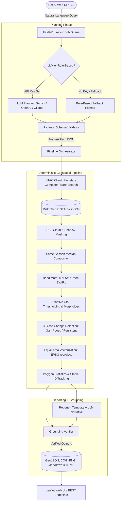

# System Architecture

## Overview

`satellite-image-analyst` provides an end-to-end framework enabling non-experts to query Earth-observation imagery using natural language while guaranteeing scientific defensibility through deterministic computation.

## Core Components

### 1. `satellite_analyst.planner`
- **Schema (`schema.py`)**: Pydantic models defining `AnalysisPlan`, `TimeInterval`, `BoundingBox`, `SeasonPolicy`, etc.
- **Geocoding (`geocode.py`)**: Cached Nominatim spatial resolver converting place names to geographic bounds.
- **LLM Base & Providers (`llm_base.py`, `providers/`)**: Pluggable interface for Google Gemini, OpenAI-compatible APIs, and local Ollama instances.
- **Rule-Based Engine (`rule_based.py`)**: Regex parser extracting place names, years, and intents for zero-API-key operation.

### 2. `satellite_analyst.data`
- **STAC Client (`stac_client.py`)**: Searches Sentinel-2 L2A collections on Microsoft Planetary Computer or Earth Search.
- **Compositor (`composites.py`)**: Cloud, shadow, and snow masking using the Scene Classification Layer (SCL), followed by temporal median compositing.
- **Cache (`cache.py`)**: Content-hash-based caching of metadata queries and fetched sub-tiles.

### 3. `satellite_analyst.analysis`
- **Indices (`indices.py`)**: MNDWI calculation with SWIR1 band upsampling to 10m.
- **Water Masking (`water.py`)**: Otsu thresholding, binary morphology, and minimum-area blob filtering.
- **Change Detection (`change.py`)**: Categorizes pixels into:
  - `1`: Gained water (dry in Period A, water in Period B)
  - `2`: Lost water (water in Period A, dry in Period B)
  - `3`: Persistent water (water in both periods)
- **Vectorization & Stats (`vectorize.py`, `stats.py`)**: Reprojection to local equal-area CRS, polygonization, perimeter and area in hectares, centroid calculation, and stable identifier assignment.

### 4. `satellite_analyst.report`
- **Grounding Verifier (`grounding.py`)**: Scans all numerical tokens in generated narratives and verifies that every metric exists within the computed pipeline statistics.
- **Generator (`generator.py`)**: Combines Jinja2 templates and LLM summaries into defensible Markdown and HTML reports.

### 5. `satellite_analyst.api` & `web`
- **FastAPI (`main.py`, `routes.py`, `jobs.py`)**: Asynchronous job handling, streaming GeoJSON endpoints, and OpenAPI documentation.
- **Frontend (`web/`)**: Plain JavaScript + Leaflet map interface with layer toggles and interactive stats inspector.
